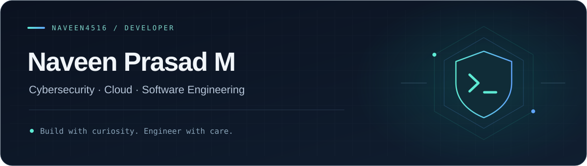

  

  
  

# Hi, I'm Naveen 👋

I'm **Naveen Prasad M**, a developer exploring **cybersecurity, cloud infrastructure, and software engineering**. I enjoy building practical tools, understanding how systems fail, and finding ways to make them safer and more resilient.

My projects span terminal safety, chaos engineering, cloud security labs, and network automation.

### What I'm focused on

- **Security tooling** — command safety, network monitoring, and automated defenses.
- **Cloud & systems** — hands-on work with AWS, Docker, and Linux.
- **Learning by building** — exploring pentesting, system architecture, and reliable software.

## Selected projects

| Project | What it explores | Built with |
| :--- | :--- | :--- |
| **[ShellGuard](https://github.com/NAVEEN4516/ShellGuard)** | A terminal command safety tool that checks potentially destructive commands against incident knowledge. | Python · FastAPI · Moss |
| **[FRACTURE](https://github.com/NAVEEN4516/FRACTURE-chaos-engineering)** | A chaos engineering CLI for testing how containerized services respond to memory pressure, CPU limits, and load. | Python · Docker · HTTPX |
| **[AWS Security Lab](https://github.com/NAVEEN4516/aws-ec2-docker-pentest-lab)** | A self-hosted EC2 lab covering container deployment, network isolation, and documented reconnaissance. | AWS EC2 · Docker · Nmap |
| **[Dynamic Host Blocker](https://github.com/NAVEEN4516/dynamic-host-blocker)** | An SDN experiment that detects high packet rates and installs OpenFlow rules to block suspicious hosts. | Python · Mininet · Open vSwitch |

## Tools I work with

  
  
  
  
   
  
  
  
  

**Also in my toolkit:** HTML/CSS · Nmap · Docker Compose · web reconnaissance

## Let's build something useful

I'm open to collaborating on **security tools, system utilities, and open-source projects**.

[Email me](mailto:naveenprasad4516@gmail.com) · [Browse my repositories](https://github.com/NAVEEN4516?tab=repositories) · [Explore my portfolio repository](https://github.com/NAVEEN4516/Portfolio)

---

Curious about the system. Careful with the details. Always building.
